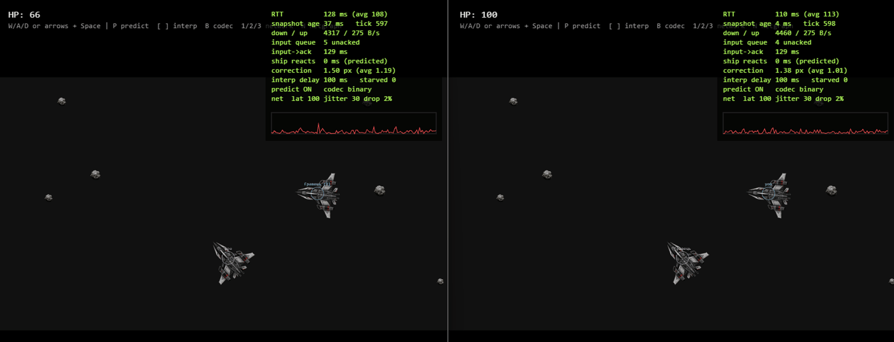
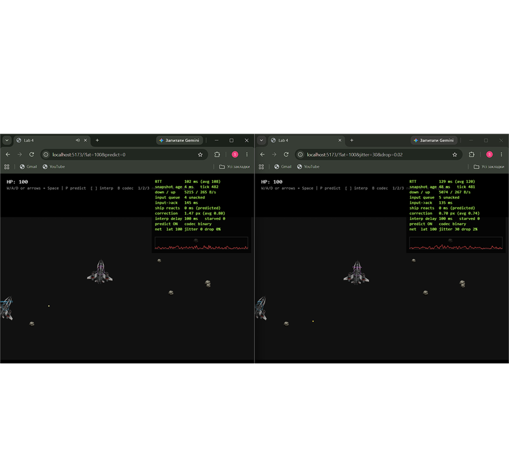
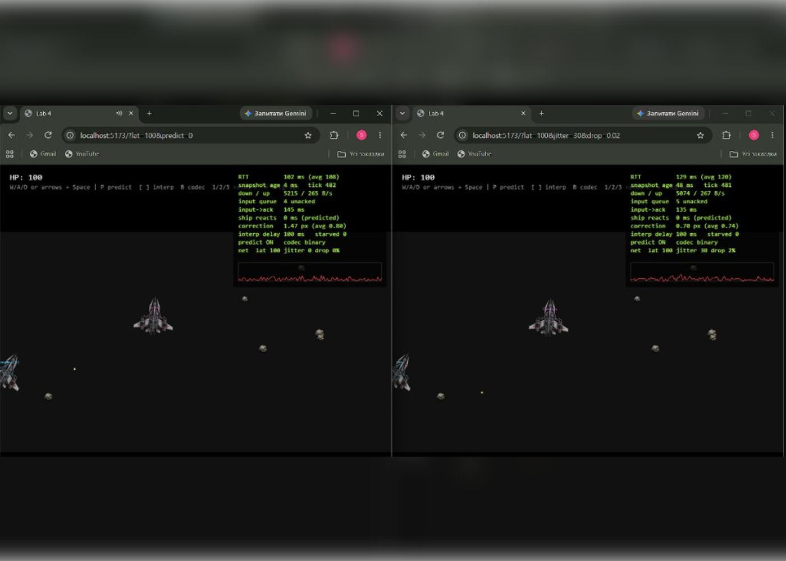

# Lab 5: авторитетний сервер, передбачення, інтерполяція, бінарний протокол

> **Демонстрація двох гравців у реальному часі:** робота авторитетного сервера з передбаченням свого корабля, інтерполяцією супротивника та штучною затримкою/розкидом (`?lat=100&jitter=30&drop=0.02`):
>
> 


## Як це влаштовано

```
shared/   чиста симуляція (sim.js), seed-генератор (rng.js), протокол (codec.js) — без DOM і без модулів Node
server/   Match на кімнату: 30 тіків/с, setTimeout на абсолютний цільовий час, валідація input, LinkSim (штучна мережа)
client/   Predictor (передбачення + звірка), Interpolator, NetStats, NetGame (цикл, малювання, netgraph)
```

- **Клієнт надсилає лише input** `{seq, thrust, turn, fire}`. Координат у протоколі немає, тому «телепорт» через DevTools неможливий. `sanitizeInput` відкидає (а не обрізає) `turn: 1000`; є ліміт частоти (token bucket) і максимум 8 input у черзі.
- **Один input = один крок.** Якщо input не встиг, корабель цього тіка стоїть (`starved`), якщо накопичилось — береться по одному за тік. Завдяки цьому клієнт може точно програти непідтверджені input.
- **Знімок** містить `tick` і `ack` (останній застосований `seq` саме цього клієнта).
- **Своя куля** з'являється одразу (id `-seq`) і живе локально; коли сервер підтвердив `seq`, а його кулі вже нема (влучила/вичерпала ttl) — локальна зникає. Чужі кулі інтерполюються.
- Симуляція нова (не перенесена 1:1): кораблі, кулі, астероїди, зіткнення, респавн. Підбирання (`Pickup`) зі старого клієнта не переносив.
- Старі `World/Ship/Bullet/Entity/Asteroid/Particle/Pickup/Vector2/components/physics` з `client/src` видалено — їх замінив `shared/src/sim.js`.

### Бінарний формат (версія 1, little-endian)

Повна специфікація — коментар на початку [`shared/src/codec.js`](shared/src/codec.js). Коротко:
`u8 версія, u8 тип`; input — 8 байт (`u32 seq`, `u8 прапорці`, `i8 turn`); знімок — 15 байт заголовка (`u32 tick`, `u32 ack`, лічильники) + кораблі по 25 Б, кулі по 20 Б, астероїди по 13 Б. Кут — `Int16` у 1/10000 рад (точність 0.0057°). JSON лишається для порівняння (`?codec=json`). Службові повідомлення (`join`, `welcome`, `ping`…) завжди JSON.

## Вимірювання

JSON проти бінарного, 30 Гц, 4 гравці (4 кораблі, 12 куль, 3 астероїди), `node shared/test/bench.mjs` (Node 26, мій ПК):

| Codec | Байт/знімок | КБ/с на клієнта (вниз) | Байт/input | КБ/с на клієнта (вгору) | Encode+decode, µс |
|---|---|---|---|---|---|
| JSON | 1832 | 53.67 | 59 | 1.73 | 9.2 |
| Binary (`DataView`) | 394 | 11.54 | 8 | 0.23 | 2.3 |

Бінарний знімок у 4.6 раза менший, input — у 7.4 раза; кодування+декодування швидше у ~4 рази.

Розбіжність передбаченого стану зі станом сервера (поправка при знімку, px), `node shared/test/experiment.mjs` — **симульована** мережа в процесі (справжні `shared`, codec і `Predictor`, віртуальний годинник), 30 с, 2 гравці:

| Умови | Середня | p95 | Макс |
|---|---|---|---|
| RTT 0 | 0 | 0 | 0 |
| RTT 100 | 0 | 0 | 0 |
| RTT 200 | 0 | 0 | 0 |
| RTT 100 ±30, 2 % втрат | 0.04 | 0 | 5.7 |

Без втрат поправка нульова навіть при RTT 200 (кут у `Int16` дає <0.001 px). Відхилення з'являються, коли input губиться (сервер не зробив крок, який клієнт уже передбачив) або запізнюється (крок пропущено) — ці 5–6 px згладжуються за ~100 мс.

## Запис на сторінку: netcode

**Три проблеми.**
1. *Затримка.* Без передбачення корабель рухається лише через RTT після натискання (при 100 мс це відчутно як «ковзання по милу»). Свій корабель тепер рухається одразу тим самим `integrate`, що й на сервері; знімок лише виправляє його.
2. *Узгодженість.* Світ рахує тільки сервер, усі бачать один стан; клієнт звіряється зі знімком: ставить корабель у стан сервера, відкидає `seq ≤ ack` і заново програє решту input. Поправку не показуємо стрибком, а розтікаємо експоненційно (≈95 % за 100 мс).
3. *Чіти.* Клієнт не може сказати серверу, де він; невалідний input відхиляється, частота обмежена, постріл/кулдаун/урон рахує сервер.

**Затримка до/після передбачення.** Netgraph: у режимі `?predict=0` (клавіша `P`) при `lat=100` корабель реагує лише після отримання підтвердженого знімка від сервера (`ship reacts after ~157 ms`), а при увімкненому передбаченні — реакція миттєва (`ship reacts: 0 ms (predicted)`), хоча час підтвердження сервером `input->ack` лишається тим самим (~157 мс).



**Баг із детермінізмом (навмисний).** У `integrate` додав `next.vx += (Math.random() - 0.5) * 400 * dt` (клієнт і сервер витягують різні числа), через що передбачений стан розходиться з авторитетним, і клієнту доводиться постійно підправляти корабель (`correction` підскакує до 1–2 px, а графік починає стрибати):



Таблиця результатів розбіжності за симуляцією `experiment.mjs`:

| Умови | Середня поправка, px (було → стало) | Макс, px |
|---|---|---|
| RTT 0 | 0 → 0.32 | 1.1 |
| RTT 100 | 0 → 0.73 | 2.7 |
| RTT 200 | 0 → 1.58 | 6.3 |
| RTT 100 ±30, 2 % | 0.04 → 1.12 | 311 |

Висновок: поправка росте разом із кількістю input, які треба програти (тобто із затримкою), а `simSelfTest()` двічі дає різні хеші (`366322189` ≠ `2351585862`). Після відкату хеш знову стабільний (`npm test` перевіряє це і ще те, що в `shared/src` нема `Math.random`/`Date.now`/DOM). Це симуляція, а не запис у браузері — скріншот netgraph з цим експериментом додати вручну.

**Затримка інтерполяції: 100 мс.** Інтервал знімків — 33 мс. Два інтервали (66 мс) вистачає, поки jitter малий, але при ±30 мс і втраті 2 % знімка може не бути на потрібний момент, і чужий корабель завмирає (`starved` у netgraph росте). Три інтервали (100 мс) дають запас на один втрачений знімок плюс розкид; більше — чужі кораблі надто «в минулому» (по них стріляєш туди, де їх уже немає, а лаг-компенсації тут нема). Значення 100 мс змінюється клавішами `[` `]`, підібране за netgraph при `lat=100&jitter=30&drop=0.02`; на реальній мережі не перевірялось.

**Таймер сервера.** `setTimeout` на `nextTick += 33.33` замість `setInterval`; при відставанні >5 тіків — ресинхронізація (`overruns`). На Windows `setTimeout` має зерно ~15 мс: у пробному запуску `jitterMsAvg ≈ 7 мс`, `max ≈ 15 мс`, `tickMsAvg ≈ 0.14 мс`. Цільовий час не зсувається, тож середня частота лишається 30 Гц.


---

# Lab 6: TypeScript для протоколу, симуляції та обох боків мережі

## 1. Рішення щодо фронтенд-фреймворку (Framework Decision)

Для лобі та HUD було прийнято рішення залишити **Vanilla TypeScript + Canvas API + типізовану шину подій `Bus<GameEvents>`** без додавання React, Svelte або Vue:
- **Нульовий оверхед бандлу:** клієнт збирається у чистий Vite-бандл розміром лише ~115 КБ (35 КБ gzip), тоді як підключення React додало б додаткові десятки кілобайт рантайму, який не потрібен для простого вибору кімнати та відображення кількох полів HUD.
- **Простота життєвого циклу:** оновлення HUD та графіка мережі (`NetStats`) відбуваються синхронно з ігровим циклом `requestAnimationFrame` (60 FPS) безпосередньо через 2D Context Canvas. Декларативний Virtual DOM або реактивність UI-фреймворків лише створювали б додаткові алокації об'єктів та навантаження на Garbage Collector у кожному кадрі.
- **Повна типізація без реактивного клею:** написаний клас `Bus<GameEvents>` та строга типізація `Connection` надали 100% строгий контракт подій без потреби у зовнішніх стейт-менеджерах.

---

## 2. Що знайшов TypeScript (What TypeScript Found)

Під час міграції кодової бази під найсуворіші правила `strict: true` та `noUncheckedIndexedAccess: true` TypeScript виявив низку потенційних помилок та граничних випадків:

1. **Небезпечний доступ до елементів масиву (`noUncheckedIndexedAccess`):**
   У `Interpolator.sample` вирази `this.snaps[i - 1]` та `this.snaps[i]` раніше вважалися гарантовано існуючими об'єктами. TypeScript вказав, що вони мають тип `Snapshot | undefined`. Якби масив знімків містив лише один елемент або виявився порожнім, це призвело б до рантайм-помилки `TypeError: Cannot read properties of undefined (reading 'tick')`. Додано явні перевірки `if (!a || !b)`.

2. **Підміна та плутанина ідентифікаторів/послідовностей (`Seq` vs `number`):**
   У `server/ws.ts` вхідне необроблене повідомлення `msg.seq` передавалося напряму в функції, що очікували порядковий номер вводу. TypeScript заблокував передачу сирого `number` туди, де очікувався branded-тип `Seq`, що змусило прогнати сирі дані через `sanitizeInput` / `asSeq` перед збереженням у стан гравця.

3. **`Map.get` повертає `undefined`:**
   У `NetGame.ts` звернення `this.players.get(s.id)` та `this.sentAt.get(snap.ack)` не враховували, що гравця або пакету може не бути в мапі (наприклад, гравець щойно вийшов, або пакет ще не надсилався). TypeScript зобов'язав явно перевіряти наявність значення перед його використанням у математичних розрахунках часу пілінгу або відображенні нікнейму.

4. **Відсутність валідації тіла запитів:**
   У `server/index.ts` при парсингу тіла POST `/api/rooms` відсутність поля `name` або його некоректний тип раніше міг спричинити створення кімнати з назвою `undefined`. Впровадження схеми `RoomBodySchema` через Zod унеможливило створення некоректних кімнат на рівні API.

5. **Вичерпність обробки типів повідомлень (`never` default):**
   У диспетчерах повідомлень сервера та клієнта додано конструкцію `default: const _exhaustive: never = msg; return _exhaustive;`. Це гарантує на етапі компіляції, що при додаванні нового типу повідомлення (наприклад, `chat`) компілятор видасть помилку, доки розробник не напише для нього обробник у `switch`.

---

## 3. Три цікаві типи (Three Explained Types)

### 1. Номінальні брендовані типи (`EntityId`, `Tick`, `Seq`)

```ts
export type EntityId = number & { readonly __brand: 'EntityId' };
export type Tick = number & { readonly __brand: 'Tick' };
export type Seq = number & { readonly __brand: 'Seq' };
```
*Пояснення простими словами:*
У JavaScript і звичайному TypeScript будь-яке число — це просто `number`. Через це можна випадково передати номер кадру (`tick = 120`) замість ідентифікатора корабля (`id = 120`), і JavaScript навіть не попередить про помилку.
Брендований тип додає до числа уявне поле `__brand`, якого насправді не існує в пам'яті в рантаймі (нульові витрати продуктивності), але компілятор тепер вважає `EntityId` та `Tick` абсолютно несумісними різними типами. Щоб перетворити звичайне число на безпечний ідентифікатор, викликається конструктор `asEntityId(n)`.

### 2. Дискриміноване об'єднання з перевіркою вичерпності (`discriminated union` + `never`)

```ts
export type EntitySnapshot = ShipSnapshot | BulletSnapshot | AsteroidSnapshot;

function renderEntity(entity: EntitySnapshot): void {
  switch (entity.kind) {
    case 'ship': return drawShip(entity);
    case 'bullet': return drawBullet(entity);
    case 'asteroid': return drawAsteroid(entity);
    default: {
      const _exhaustive: never = entity;
      return _exhaustive;
    }
  }
}
```
*Пояснення простими словами:*
Усі типи сутностей у знімку мають спільне строкове поле `kind` (`'ship'`, `'bullet'`, `'asteroid'`). Коли ми пишемо `switch (entity.kind)`, всередині блоку `case 'ship'` TypeScript точно знає, що це саме корабель, і дозволяє звертатися до його здоров'я `hp` чи `cooldown`.
Блок `default` з присвоєнням до типу `never` діє як компіляторний капкан: якщо завтра ми додамо новий тип сутності (наприклад, `{ kind: 'pickup' }`), компілятор негайно видасть червону помилку на рядку `const _exhaustive: never = entity`, вказавши, що ми забули додати новий `case` у `switch`.

### 3. Узагальнена строго типізована шина подій (`Bus<Events extends object>`)

```ts
export class Bus<Events extends object> {
  on<K extends keyof Events & string>(event: K, handler: (data: Events[K]) => void): () => void;
  emit<K extends keyof Events & string>(event: K, data: Events[K]): void;
}
```
*Пояснення простими словами:*
Звичайна шина подій у JavaScript (`EventTarget` або `EventEmitter`) приймає будь-яке ім'я події як рядок і довільні дані, тому легко зробити друкарську помилку на кшталт `bus.emit('plaer_hit')` замість `bus.emit('player_hit')`.
Дженерик `Bus<Events>` прив'язує назву події `K` до конкретного типу аргументу `Events[K]`. Тепер редактор автоматично підказує доступні назви подій, а якщо спробувати передати невідповідні дані (наприклад, рядок замість об'єкта зі здоров'ям), компілятор TypeScript відхилить код ще до запуску.

